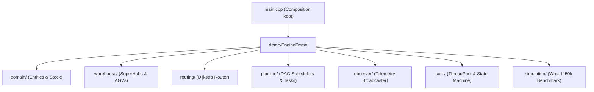

# ⚡ QuickFlow High-Performance C++ Logistics & Routing Engine

A production-grade, multi-threaded logistics orchestration engine designed with core Object-Oriented Programming (OOP) principles, Gang of Four (GoF) design patterns, and systems engineering best practices.

---

## 🏛️ Neutralinojs-Style Modular Architecture

The engine follows a feature-co-located module hierarchy where headers (`.hpp`) and implementations (`.cpp`) live together in domain-specific packages:



---

## 📂 Directory Layout

```
cpp-engine/
├── CMakeLists.txt              # Modern Target-Based CMake Build Config
├── Dockerfile                  # Multi-Stage Alpine Linux Container
├── .clang-format               # Google Modern C++17 Style Rules
├── README.md                   # Technical Engine Architecture Docs
├── main.cpp                    # Clean Master Orchestrator (Dependency Injection)
│
├── domain/                     # 📦 Core Domain Entities
│   ├── Customer.hpp & .cpp     # Encapsulated Customer Model
│   ├── Product.hpp & .cpp      # Physical SKU Catalog & Storage Slots
│   ├── Inventory.hpp & .cpp    # Thread-Safe Stock Domain (RAII Mutex)
│   └── Order.hpp & .cpp        # Order Lifecycle & Task DAG Generation
│
├── warehouse/                  # 🏭 SuperHub Network & Workforce
│   ├── Warehouse.hpp & .cpp    # Hub Capacity, Utilization & Cost Scoring
│   ├── WarehouseManager.hpp & .cpp # Hash Table O(1) Hub Registry
│   └── WorkerManager.hpp & .cpp# AGV Robotics Fleet & Worker Roster
│
├── core/                       # ⚙️ Concurrency & State Machine
│   ├── Compat.hpp              # Cross-Platform Concurrency Layer
│   ├── ThreadPool.hpp & .cpp   # Worker Thread Pool & Synchronized Queue
│   ├── EventBus.hpp & .cpp     # Timestamped Pub-Sub Telemetry Event Bus
│   └── OrderStateMachine.hpp & .cpp # State Pattern Invariant Guards
│
├── routing/                    # 🗺️ Graph Routing Engine
│   └── GraphRouter.hpp & .cpp  # Dijkstra Shortest-Path Optimizer O(E + V log V)
│
├── pipeline/                   # ⚡ Task Execution & Schedulers
│   ├── Task.hpp & .cpp         # Polymorphic Task Hierarchy & TaskFactory
│   ├── Scheduler.hpp & .cpp    # Strategy Pattern (FIFO, Priority, Deadline, Hybrid)
│   ├── OrderProcessor.hpp & .cpp # End-to-End Orchestrator
│   └── ResilienceQueue.hpp & .cpp # Circuit Breaker Quarantine Review Queue
│
├── observer/                   # 📡 Telemetry & Notifications
│   ├── Observer.hpp & .cpp     # IOrderObserver Interface & Loggers
│   └── NotificationManager.hpp & .cpp # Observer Pattern Subject Broadcaster
│
├── simulation/                 # 📊 What-If Capacity Simulator
│   └── Simulator.hpp & .cpp    # 50,000 Order 4-Algorithm Benchmark Matrix
│
├── demo/                       # 🎬 Execution Runner
│   └── EngineDemo.hpp & .cpp   # Modular 9-Stage Architecture Showcase
│
└── tests/                      # 🧪 Automated Test Suite
    └── unit_tests.cpp          # Automated Invariant Test Harness
```

---

## 🎨 Gang of Four (GoF) Patterns Implemented

1. **Strategy Pattern** ([`pipeline/Scheduler.hpp`](file:///c:/Users/gupta/Desktop/oops_project/cpp-engine/pipeline/Scheduler.hpp)): Pluggable runtime dispatch algorithms (`FIFOScheduler`, `PriorityScheduler`, `DeadlineScheduler`, `HybridScheduler`).
2. **State Pattern** ([`core/OrderStateMachine.hpp`](file:///c:/Users/gupta/Desktop/oops_project/cpp-engine/core/OrderStateMachine.hpp)): Validated order lifecycle with strict transition guards preventing invalid leaps.
3. **Factory Method Pattern** ([`pipeline/Task.hpp`](file:///c:/Users/gupta/Desktop/oops_project/cpp-engine/pipeline/Task.hpp)): `TaskFactory` instantiates polymorphic fulfillment task subclasses.
4. **Observer Pattern** ([`observer/Observer.hpp`](file:///c:/Users/gupta/Desktop/oops_project/cpp-engine/observer/Observer.hpp)): Decoupled telemetry logging and real-time order state event broadcast.
5. **Circuit Breaker / Quarantine Queue** ([`pipeline/ResilienceQueue.hpp`](file:///c:/Users/gupta/Desktop/oops_project/cpp-engine/pipeline/ResilienceQueue.hpp)): Isolates failing tasks after 3 transient retry attempts.

---

## 🔨 Build & Execution Instructions

### 1. Build & Run Application
```bash
# Compile Engine Binary
g++ -std=c++17 -I. main.cpp domain/*.cpp warehouse/*.cpp core/*.cpp routing/*.cpp pipeline/*.cpp observer/*.cpp simulation/*.cpp demo/*.cpp -o quickflow_engine.exe

# Execute Engine
./quickflow_engine.exe
```

### 2. Run Automated Unit Test Suite
```bash
# Compile Test Runner
g++ -std=c++17 -I. tests/unit_tests.cpp domain/*.cpp warehouse/*.cpp core/*.cpp routing/*.cpp pipeline/*.cpp observer/*.cpp simulation/*.cpp demo/*.cpp -o quickflow_tests.exe

# Execute Unit Tests
./quickflow_tests.exe
```
